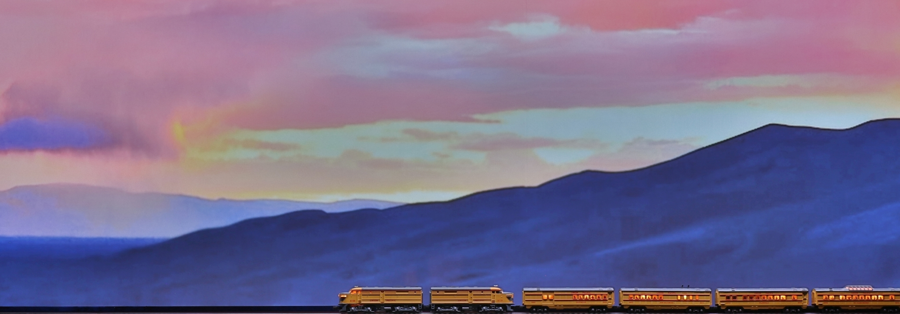

# Dynamic-Scene-Projection

.

Consider a simple circle of track with a carefully placed projection surface where images of scenes from around the world could be projected.  Suddenly it would be possible to model a passenger train visiting various stations along a path much larger than possible if instead there are physical models of stations placed around the same circle.  Dynamic scene projection supports the cereation of a "virtual" railroad that can be as large as the set of photographs you have to display.  Along with carefully controlled lighting (See  https://github.com/pfr/Model-Train-Lighting ) dyanmically projected scenes can add a whole new dimension to model railroading.

In the image above, the train is proceeding in front of a 12' wide projected image.  The train itself is lit using an LED strip-lit slit GOBO placed above it.

In early 2026 I've had a paper, "Dynamic Scene Projection," on this topic accepted by Model Railroader Magazine (https://www.trains.com/mrr/).  Watch for it in the near future.

Software here supports multi-projector display of panoramic images.  Starting with images that have been cropped and resized to specified, this software: 1) performs partitioning, mask creation, combination of masks and images, and output of a 4k image intended to be sent to a wall controller for projection; 2) manages distribution of commands for determining when and where to display an image; and 3) receives projection commands and forwards masked 4k images on to a wall controller for display by two or more projectors.  

